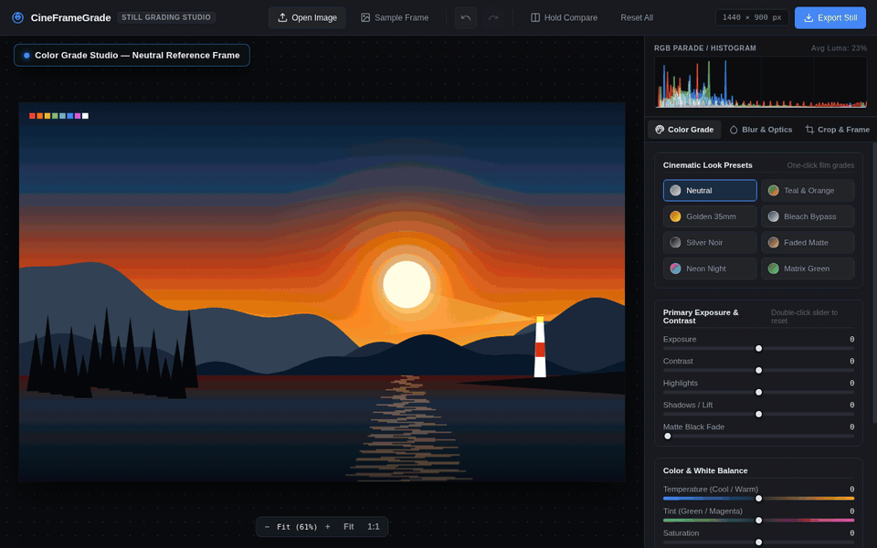
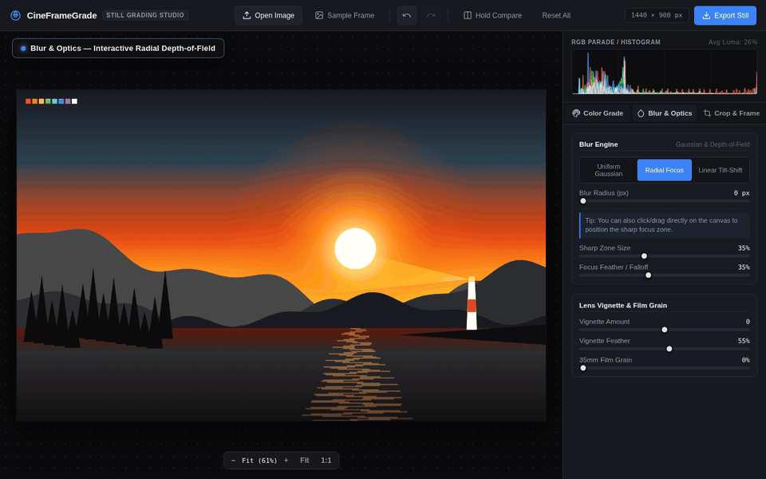
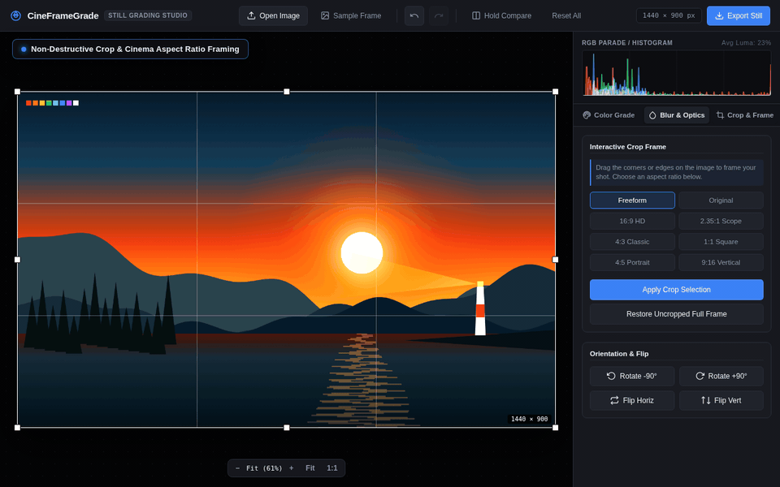
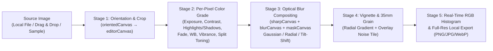

<div align="center">

# 🎬 CineFrameGrade

### **Browser-Based Still Footage & Photo Color Grading Studio**
*Zero-Dependency HTML5 Canvas 2D Color Grading, Optical Depth-of-Field Blur, Real-Time RGB Parade Histogram & Cinema Framing — 100% Local in Your Browser*

[-22c55e?style=flat-square)](#architecture--rendering-pipeline)
[](#architecture--rendering-pipeline)
[](#why-cineframegrade)
[](#non-destructive-cinema-framing--export)
[](#license)

[**🎥 Watch Video Demos**](#-video-showcases) · [**✨ Core Features**](#-core-features) · [**🚀 Quick Start**](#-quick-start) · [**⌨️ Keyboard Shortcuts**](#️-keyboard-shortcuts) · [**🏗️ Rendering Pipeline**](#️-architecture--rendering-pipeline) · [**❓ FAQ**](#-frequently-asked-questions-faq)

</div>

---

## 📖 Overview

**CineFrameGrade** is a lightweight, studio-grade **still footage and photo color grading web application** built entirely with **pure Vanilla JavaScript, HTML5 Canvas 2D, and CSS3**—with zero external libraries, zero build steps, and zero cloud uploads.

Designed for **filmmakers, colorists, photographers, and digital artists**, CineFrameGrade brings a dark-room grading console directly into any modern web browser. Evaluate luminance and channel balance with a **live RGB Parade / Histogram**, apply one-click **35mm cinema film look presets**, dial in **split toning** across shadows and highlights, simulate **radial and tilt-shift depth-of-field optics**, layer **procedural 35mm film grain**, and frame shots in **2.35:1 Anamorphic Scope** before exporting full-resolution masters locally.

---

## 🎥 Video Showcases

### 1. Real-Time Color Grading, Film Look Presets & RGB Parade Histogram
Watch **CineFrameGrade** cycle through its 8 one-click cinematic film grades (*Teal & Orange*, *Golden 35mm*, *Bleach Bypass*, *Silver Noir*, *Faded Matte*, *Neon Night*, and *Matrix Green*), fine-tune primary exposure and white balance sliders with live RGB histogram feedback, and perform an instant **Hold Compare** (`\`) before/after check:

<div align="center">
  
  <br />
  <sub>
    🎬 <strong>Video Files:</strong>
    <a href="assets/videos/cineframegrade-color-grading.mp4">Download MP4 (H.264)</a> ·
    <a href="assets/videos/cineframegrade-color-grading.webm">Download WebM (VP9)</a>
  </sub>
</div>

---

### 2. Optical Depth-of-Field Blur, Interactive Tilt-Shift & 35mm Film Grain
Explore the **Blur & Optics** engine: position the interactive focus zone directly on the canvas for **Radial Focus** bokeh falloff, switch to **Linear Tilt-Shift** with adjustable plane rotation (`-90°` to `+90°`), and finish the frame with **Optical Lens Vignette** and **Procedural 35mm Film Grain**:

<div align="center">
  
  <br />
  <sub>
    🎬 <strong>Video Files:</strong>
    <a href="assets/videos/cineframegrade-optics-blur.mp4">Download MP4 (H.264)</a> ·
    <a href="assets/videos/cineframegrade-optics-blur.webm">Download WebM (VP9)</a>
  </sub>
</div>

---

### 3. Non-Destructive Cinema Aspect Ratio Cropping & Full-Resolution Master Export
Frame your still in **2.35:1 Anamorphic Cinema Scope**, **16:9 HD**, **4:5 Portrait**, or **1:1 Square** using the interactive rule-of-thirds overlay, restore the uncropped frame at any time, and export full-resolution graded stills in **Lossless PNG**, **JPEG**, or **WebP**:

<div align="center">
  
  <br />
  <sub>
    🎬 <strong>Video Files:</strong>
    <a href="assets/videos/cineframegrade-crop-export.mp4">Download MP4 (H.264)</a> ·
    <a href="assets/videos/cineframegrade-crop-export.webm">Download WebM (VP9)</a>
  </sub>
</div>

---

## ✨ Core Features

### 🎨 Color Grading & Split Toning Console
- **Live RGB Parade / Histogram & Average Luminance Readout:** Real-time 256-bin Red, Green, Blue, and Rec.709 Luminance distribution calculated directly from the graded canvas.
- **8 One-Click Cinematic Film Presets:** Instant stylistic starting points that populate the underlying grading controls so you can customize every look further.
- **Primary Light & Tonality Controls:**
  - **Exposure** (`-100` to `+100`) — Exponential EV stop simulation (`2^(ev)`).
  - **Contrast** (`-100` to `+100`) — Midpoint pivot contrast around neutral gray.
  - **Highlights** (`-100` to `+100`) — Targeted high-luminance recovery or boost.
  - **Shadows / Lift** (`-100` to `+100`) — Shadow detail recovery or crushing.
  - **Matte Black Fade** (`0` to `100`) — Analog film toe floor lift for classic matte looks.
- **Color Balance & White Balance:**
  - **Temperature** (`-100` Cool Blue to `+100` Warm Amber) & **Tint** (`-100` Green to `+100` Magenta).
  - **Saturation** (`-100` Monochrome to `+100`) & **Vibrance** (`-100` to `+100` selective low-saturation boost that protects skin tones and already-saturated hues).
  - **Hue Shift** (`-180°` to `+180°` color wheel rotation) & **Sepia Tone** (`0%` to `100%`).
- **Two-Way Split Toning:** Independent color pickers and strength sliders (`0%` to `100%`) for **Shadow Tint** and **Highlight Tint** weighted smoothly by pixel luminance.

### 🎞️ Built-In Cinematic Look Presets

| Preset Name | Style Profile | Key Grading Characteristics |
| :--- | :--- | :--- |
| **Neutral** | Unmodified Source | Flat `0` baseline across all primary, color, and split-tone channels |
| **Teal & Orange** | Blockbuster Cinema | Deep teal shadows (`#0d5c75`), warm amber highlights (`#f59e0b`), punchy contrast (`+18`), boosted vibrance (`+22`) |
| **Golden 35mm** | Warm Analog Kodak Stock | Warm color temperature (`+28`), lifted shadows (`+12`), subtle sepia warmth (`14%`), golden highlight tint |
| **Bleach Bypass** | Silver Retention Lab Look | High contrast (`+42`), desaturated chroma (`-52`), crushed shadows (`-18`), metallic slate split tone |
| **Silver Noir** | Classic B&W Monochrome | Full desaturation (`-100`), rich contrast (`+38`), deep shadows (`-22`), subtle warm silver-gelatin tone |
| **Faded Matte** | Vintage Editorial Film | Lifted matte black floor (`+38`), soft contrast (`-14`), rolled-off highlights (`-24`), warm plum/cream tones |
| **Neon Night** | Cyberpunk / Synthwave | Cool temperature (`-22`), magenta tint (`+36`), high vibrance (`+35`), indigo shadow & hot-pink highlight split |
| **Matrix Green** | Sci-Fi Emerald Cast | Green-shifted tint (`-34`), cool temperature (`-18`), high contrast (`+22`), deep forest shadow & mint highlight tint |

### 🔭 Blur & Optical Depth-of-Field Engine
- **Three Optical Blur Modes (`0 px` to `50 px`):**
  1. **Uniform Gaussian Blur:** Smooth full-frame optical softening.
  2. **Radial Focus (Spot Bokeh):** Keeps a customizable circular focal region sharp while progressively blurring the surrounding frame. Click or drag directly on the canvas to position the subject focus point.
  3. **Linear Tilt-Shift (Miniature / Diopter Simulation):** Creates an angled plane of sharp focus with smooth gradient feathering on both sides. Supports interactive canvas positioning and **Tilt Plane Angle** rotation (`-90°` to `+90°`).
- **Optical Lens Vignette:** Darken (`-100`) or brighten (`+100`) frame corners with adjustable **Vignette Feather** (`10%` to `95%`).
- **Procedural 35mm Film Grain:** Pre-generated Gaussian noise tile composited with `overlay` blending (`0%` to `100%`) for authentic celluloid texture.

### 📐 Non-Destructive Cinema Framing & Export
- **Interactive Crop Box with Rule-of-Thirds Grid:** Drag 8-way resize handles (`N`, `S`, `E`, `W`, `NW`, `NE`, `SW`, `SE`) or pan the crop window directly over the viewport with a live pixel resolution badge.
- **8 Aspect Ratio Presets:** `Freeform`, `Original`, `16:9 HD`, `2.35:1 Anamorphic Scope`, `4:3 Classic`, `1:1 Square`, `4:5 Portrait`, and `9:16 Vertical`.
- **Orientation & Transforms:** `-90°` / `+90°` lossless rotation and horizontal/vertical mirror flips.
- **Full-Resolution Local Export:** Exports at the exact cropped pixel dimensions of your source image in **PNG (Lossless Master)**, **JPEG**, or **WebP** with adjustable compression quality (`10%` to `100%`).

---

## 🏗️ Architecture & Rendering Pipeline

CineFrameGrade uses a **multi-stage offscreen HTML5 Canvas 2D pipeline** in [`app.js`](app.js) so that orientation, cropping, per-pixel LUT/math grading, depth-of-field masking, vignette, and film grain remain 100% non-destructive:



### Why CineFrameGrade?
- **🔒 100% Local Privacy:** Photos and still frames never leave your machine. All pixel processing runs inside your browser's memory via `CanvasRenderingContext2D` and `ImageData`.
- **⚡ Zero Build Tooling or Dependencies:** No `node_modules`, no bundlers, no external CDNs, and no account sign-ups. Open [`index.html`](index.html) and start grading immediately.
- **🎯 Precision UI Ergonomics:** Double-click any slider to reset that single parameter to its default value, use `Ctrl+Z` / `Ctrl+Y` (up to 35 undo states), or hold `\` to compare against the ungraded original.

---

## 🚀 Quick Start

### Option 1: Open Directly in Any Browser
Because **CineFrameGrade** has zero external runtime dependencies, you can launch it directly from the filesystem:

```bash
git clone https://github.com/your-username/cineframegrade.git
cd cineframegrade
xdg-open index.html   # Linux
# or: open index.html (macOS) / start index.html (Windows)
```

### Option 2: Serve with a Local Static HTTP Server
```bash
# Using Python 3
python3 -m http.server 8080

# Or using Node.js npx serve
npx serve .
```
Then visit `http://localhost:8080` in Chrome, Chromium, Firefox, Edge, or Safari.

---

## ⌨️ Keyboard Shortcuts & Viewport Controls

| Shortcut / Interaction | Action |
| :--- | :--- |
| **`Ctrl + Z`** (or `Cmd + Z`) | Undo last grading or crop adjustment (35-step history stack) |
| **`Ctrl + Y`** (or `Cmd + Shift + Z`) | Redo adjustment |
| **Hold `\` (Backslash)** | Hold to compare **Original Ungraded** frame vs. graded output |
| **Double-Click Any Slider** | Reset that individual slider to its neutral default value |
| **Drag Image onto Window** | Load any local image (`PNG`, `JPEG`, `WebP`, `AVIF`, `GIF`, `SVG`) |
| **Click / Drag on Canvas (Blur Tab)** | Reposition the sharp focal center for **Radial Focus** or **Tilt-Shift** |

---

## 📂 Project Structure

```text
cineframegrade/
├── index.html          # Semantic HTML5 application shell, SEO metadata & JSON-LD schema
├── styles.css          # Dark-studio UI theme, custom range tracks, crop overlay & responsive HUD
├── app.js              # Non-destructive 2D Canvas grading engine, RGB histogram & export pipeline
├── assets/
│   └── videos/         # Promotional video showcases (MP4, WebM, animated GIFs & poster frame)
└── README.md           # Documentation, video showcases & SEO reference
```

---

## ❓ Frequently Asked Questions (FAQ)

<details>
<summary><strong>How do I color grade still footage or photos in my browser without uploading files to a server?</strong></summary>
<br />
Open <strong>CineFrameGrade</strong> in any modern web browser and drag-and-drop your image onto the viewport. All adjustments—including exposure, split toning, cinematic film presets, tilt-shift blur, and 35mm film grain—are computed locally on your device using HTML5 Canvas <code>ImageData</code> buffers without any network requests.
</details>

<details>
<summary><strong>Does CineFrameGrade reduce image resolution when exporting?</strong></summary>
<br />
No. CineFrameGrade renders the grading pipeline at the <strong>full native pixel resolution</strong> of your source image (adjusted only by any crop region you apply). Exporting as <strong>PNG</strong> produces a lossless full-resolution master.
</details>

<details>
<summary><strong>Can I customize a Cinematic Look Preset after clicking it?</strong></summary>
<br />
Yes. Every preset in CineFrameGrade (such as <em>Teal &amp; Orange</em>, <em>Golden 35mm</em>, or <em>Bleach Bypass</em>) works by setting the underlying Exposure, Contrast, White Balance, Saturation, and Split Toning sliders. After selecting a preset, you can fine-tune any slider or add optical blur and film grain.
</details>

<details>
<summary><strong>Why was the project renamed from LumenFrame to CineFrameGrade?</strong></summary>
<br />
To ensure a unique, descriptive brand identity with zero naming collisions on GitHub and Google Search, the project was named <strong>CineFrameGrade</strong>—reflecting its core purpose as a cinematic still-frame color grading and optics studio.
</details>

---

## 🔍 Discoverability & Search Topics (GitHub SEO)

When publishing this repository on GitHub, add the following **Repository Topics** in the *About* settings gear to maximize search indexing across GitHub and Google:

`cineframegrade` `color-grading` `photo-editor` `still-footage` `html5-canvas` `vanilla-javascript` `film-emulation` `split-toning` `rgb-histogram` `tilt-shift` `depth-of-field` `film-grain` `image-processing` `client-side` `zero-dependency`

---

## 📄 License

Released under the **MIT License**. Free for personal, educational, and commercial studio use.
